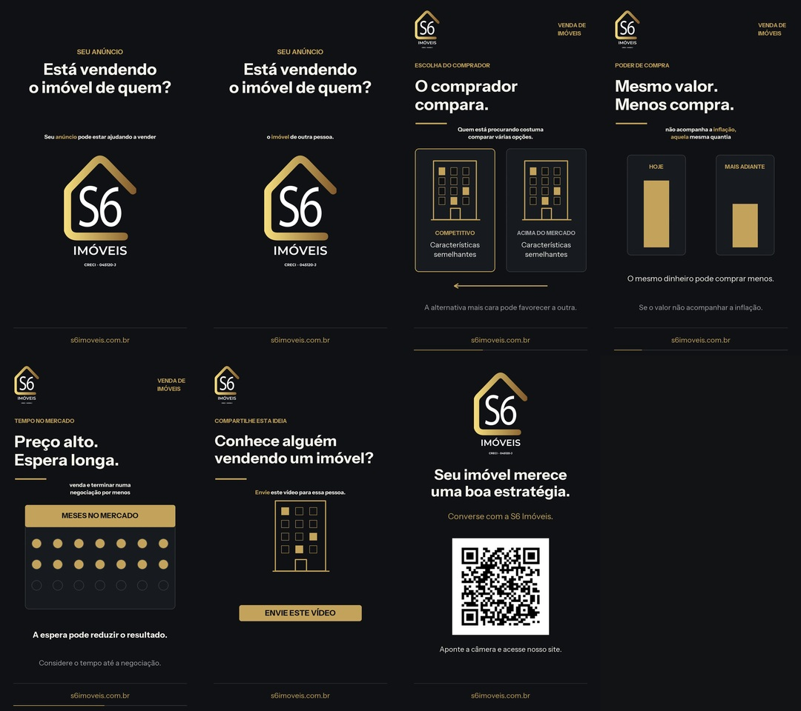

# S6Vid

Skill pública para vídeos educativos ilustrados da **S6 Imóveis**, especialmente Reels: identidade grafite/dourada, Instrument Sans, voz feminina sintética aprovada, ritmo de 1,25×, trilha discreta, legendas sincronizadas e QR code.

## Instalar e usar

Peça ao Codex para instalar a skill deste repositório ou clone seu conteúdo para `~/.codex/skills/s6vid`. Uma nova conversa pode ser necessária para atualizar a descoberta de skills.

Use **`$s6vid`** ou peça: “Crie um vídeo S6Vid sobre este assunto”. O nome exibido é **S6Vid**; o identificador técnico é `s6vid`.

O pacote contém identidade visual, fontes com licença, referência sintética da voz, projeto de exemplo e scripts portáteis. Não contém gravações pessoais, dados de clientes, credenciais, bancos de perfis ou pesos de modelos.

## Dependências

Instalar a skill não instala o aplicativo [VoiceStudio](https://github.com/debpalash/VoiceStudio) nem o modelo [VoxCPM2](https://huggingface.co/openbmb/VoxCPM2). Configure-os localmente para usar a mesma voz. As bibliotecas de vídeo estão em `requirements.txt`; o modelo local do faster-whisper para legendas também é separado.

Veja [SKILL.md](SKILL.md) e [o fluxo de produção](references/producao.md). A skill entrega vídeos para revisão, sem publicação automática nem promessa de alcance.

Código e documentação: MIT. Fontes: SIL OFL. Logo e marca S6 mantêm seus direitos próprios; o repositório não concede uso de marca ou endosso. Consulte [LICENSE](LICENSE) e [NOTICE.md](NOTICE.md).
